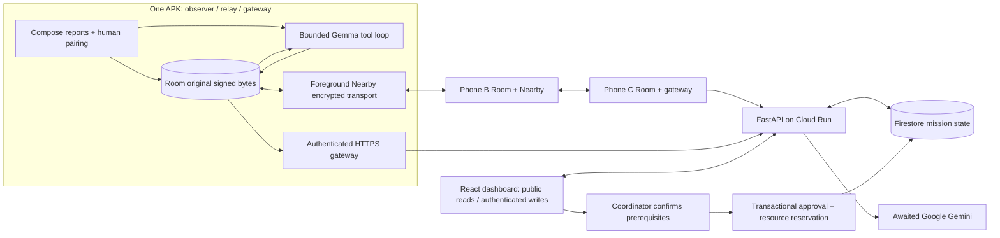

# RescueMesh architecture

## Contract and trust

See [frozen v1 contract](../contracts/README.md). Each origin creates an Android Keystore P-256 key; its public-key fingerprint is its device ID. A manually distributed mission manifest lists approved public keys. Nearby pairing requires matching digits on both screens. A separate fresh 32-byte nonce proof binds mission, both device IDs and the registered signing key. Event signatures are verified over decoded original bytes; source evidence never gets replaced with model text.

Nearby provides transport encryption; origin signatures provide provenance/tamper detection. Relays can read reports. End-to-end confidentiality and fleet enrollment/revocation services are not implemented. A manifest must be delivered by a trusted coordinator, not obtained from an unknown peer. Keystore device identity must not be cloned through backups; data extraction is disabled.

## Durability and relay

Local event insert and sequence increment are one Room transaction. Received envelopes are verified, deduplicated by event ID and checked for origin-sequence collision. The receipt/ACK is sent only after commit. New source evidence also creates a signed delivery-receipt event, identifying the last peer; receipts never create further receipts. On disconnect/restart, original bytes remain in Room. Foreground inventories restart at offset zero and enumerate actual IDs; highest sequence is never used to infer completeness. Missing requests and batches are bounded; inventories retry with exponential backoff up to 30 seconds. Insertions during pagination converge through repeated full inventories. Attachments are deferred and cannot block event exchange.

Transport payload success is not a durable application receipt. Crash before ACK triggers a retry; identical original bytes make the retry harmless. Cloud ACK marks only explicitly returned event IDs uploaded. Gateway credentials are per-device mission tokens; their hashes are stored on the backend, while origins of forwarded events can be other authorized devices. Original signatures still govern origin authorization.

## Bounded local decision loop

The application orchestrates `read_incident_evidence` → real LiteRT-LM inference → validated `request_followup` and `propose_response`. It does not grant native model tools automatic execution. At most 24 source events and 48,000 prompt characters, 4096 runtime tokens, 1600 output tokens per attempt, 180-second inference limit per attempt, and one JSON repair attempt. Over-bound input fails visibly; source evidence stays intact. All generated events commit together only if the evidence revision still matches. With automatic reassessment enabled after successful load, new evidence for the selected incident triggers a revision. Other incidents expose a manual reassessment button; no unattended agent runs.

Structured assessments require citations, uncertainty, missing information, a follow-up, response prerequisites and an allowlisted resource. A model can draft only; it cannot approve. The imported CPU Gemma 4 E2B artifact is SHA-256 and size checked against the official listing captured 14 October 2026. Model weights and photos are absent from the APK. Schema validity and ID checks cannot prove factual correctness or question usefulness; the evaluation rubric and human review are required.

## Cloud projections and approvals

Cloud store is Firestore Native. For this small, single-mission demo a **single transactional mission document** contains immutable signed events, projections/proposals, gateway receipts, approval audits and resource assignments. This is deliberately capped at 250 events and 750 KiB encoded state (below Firestore's document-size ceiling), 64 proposals and 100 bounded gateway receipt records. Large reports can reach the byte cap earlier. This is not a scalable production event store; partitioning into event documents and transactional projection metadata is follow-on work.

Local development uses SQLite WAL/FULL durability with the same state machine, enabling actual restart and competing approval tests without cloud credentials. Firestore integration is implemented, but cloud transactions have not been executed without a project/emulator. Projections group evidence by incident and retain contradictory claims; unknown→known is clarification, not automatically contradiction. Free-text contradictions need actual Gemini reassessment. Revisions hash sorted source event IDs, not timestamps. Missing referenced evidence is retained as out-of-order data; generated source-event references remain inspectable.

Gemini is invoked inside an awaited authenticated request, SDK timeout 25 seconds, overall two-attempt timeout 55 seconds. Evidence revision is checked again within the proposal transaction. A coordinator authenticates using a Google-signed ID token, matching OAuth audience and verified email allowlist. Cloud Run disables the local development token. Approval requires explicit prerequisite confirmation, exact current evidence revision and an available resource; reservation, signed versioned approval event and approval audit commit together. A P-256 central origin key/counter persists privately in the mission database and is never included in API responses; public approval records expose its public key for original-byte signature verification. This bounded demo relies on database IAM/local-file access for key storage; production signing key lifecycle is deferred. Central approvals are cloud-only and are not downloaded or relayed through phones. Previously approved audit records remain immutable when later evidence arrives; no automatic dispatch/release occurs.

Public API reads include synthetic signed data only. Operational writes require gateway or coordinator role. Cloud Run uses its service account with Datastore/AI roles and access to two named Secret Manager secrets; no cloud model credentials go to Android. UI is served from the same service and uses same-origin API requests. SDK calls and Firestore operations do not rely on untracked background jobs.

## Implemented limits

One mission, three synthetic locations, two resources, foreground peer exchange, typed reports. No photos until the physical text spike passes. No iOS, voice, medical triage, route safety certification, navigation, autonomous physical dispatch or unattended background mesh.
